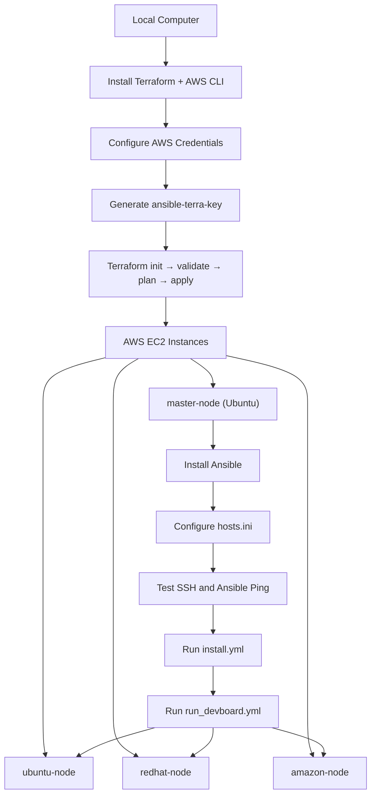

# Terraform + Ansible on AWS — Visualization Notes

## Project Goal

Create four AWS EC2 instances using Terraform from your local computer, then use Ansible installed on the Ubuntu master node to manage three worker nodes.

- **master-node:** Ubuntu + Ansible controller
- **ubuntu-node:** Ubuntu worker
- **redhat-node:** Red Hat Enterprise Linux worker
- **amazon-node:** Amazon Linux worker

## 1. Architecture Diagram



## 2. Step 1 — Install Terraform Locally

On Ubuntu or Debian:

```bash
sudo apt-get update
sudo apt-get install -y ca-certificates curl gnupg unzip wget

wget -O- https://apt.releases.hashicorp.com/gpg | \
  gpg --dearmor | \
  sudo tee /usr/share/keyrings/hashicorp-archive-keyring.gpg >/dev/null

echo "deb [signed-by=/usr/share/keyrings/hashicorp-archive-keyring.gpg] https://apt.releases.hashicorp.com $(. /etc/os-release && echo "$VERSION_CODENAME") main" | \
  sudo tee /etc/apt/sources.list.d/hashicorp.list

sudo apt-get update
sudo apt-get install -y terraform
terraform -version
```

## 3. Step 2 — Install AWS CLI v2

For an x86-64 Linux computer:

```bash
sudo apt-get update
sudo apt-get install -y curl unzip

curl "https://awscli.amazonaws.com/awscli-exe-linux-x86_64.zip" \
  -o awscliv2.zip

unzip awscliv2.zip
sudo ./aws/install

aws --version
rm -rf aws awscliv2.zip
```

Configure your AWS credentials:

```bash
aws configure
aws sts get-caller-identity
```

Enter your approved AWS access key, secret key, region `ap-south-1`, and output format `json`. Prefer short-lived credentials or AWS IAM Identity Center where available.

## 4. Step 3 — Generate SSH Key

Run locally:

```bash
mkdir -p ~/.ssh
chmod 700 ~/.ssh

ssh-keygen -t ed25519 \
  -f ~/.ssh/ansible-terra-key \
  -C "terraform-ansible-lab"

chmod 600 ~/.ssh/ansible-terra-key
chmod 644 ~/.ssh/ansible-terra-key.pub
```

The public key is used by Terraform to configure EC2 access. Keep the private key secret.

## 5. Step 4 — Terraform Project Structure

```text
terraform-ansible-lab/
├── provider.tf
├── terraform.tf
├── variable.tf
├── ec2.tf
├── output.tf
├── terraform.tfvars
└── .gitignore
```

### `terraform.tf`

```hcl
terraform {
  required_version = ">= 1.5.0"

  required_providers {
    aws = {
      source  = "hashicorp/aws"
      version = "~> 5.0"
    }
  }
}
```

### `provider.tf`

```hcl
provider "aws" {
  region = var.aws_region
}
```

### `variable.tf`

```hcl
variable "aws_region" {
  type    = string
  default = "ap-south-1"
}

variable "project_name" {
  type    = string
  default = "ansible-terra-lab"
}

variable "public_key_path" {
  type    = string
  default = "~/.ssh/ansible-terra-key.pub"
}

variable "my_ip_cidr" {
  description = "Your current public IP address followed by /32"
  type        = string
}

variable "instance_type" {
  type    = string
  default = "t3.micro"
}
```

### `ec2.tf`

Use the complete `ec2.tf` configuration from the Terraform + Ansible project guide. It must define:

1. AWS VPC and subnet lookup.
2. Ubuntu, Red Hat, and Amazon Linux AMI lookups.
3. EC2 key pair.
4. Security group allowing SSH from your IP and between lab instances.
5. Four EC2 instances named `master-node`, `ubuntu-node`, `redhat-node`, and `amazon-node`.
6. Encrypted root EBS volumes and resource tags.

### `output.tf`

```hcl
output "instance_details" {
  value = {
    for name, instance in aws_instance.node : name => {
      instance_id = instance.id
      public_ip   = instance.public_ip
      private_ip  = instance.private_ip
    }
  }
}
```

This output assumes `ec2.tf` defines the instances using `aws_instance.node` with `for_each`.

### `terraform.tfvars`

```hcl
aws_region      = "ap-south-1"
project_name    = "ansible-terra-lab"
public_key_path = "~/.ssh/ansible-terra-key.pub"
my_ip_cidr      = "YOUR_PUBLIC_IPV4/32"
instance_type   = "t3.micro"
```

Replace the IP placeholder with your actual public IPv4 address and `/32`.

## 6. Step 5 — Execute Terraform

Run locally from the project directory:

```bash
terraform fmt -recursive
terraform init
terraform validate
terraform plan -out=tfplan
terraform show tfplan
terraform apply tfplan
terraform output
```

Verify that the plan creates all four instances before applying.

## 7. Step 6 — Connect to Master

Get the master public IP from Terraform output, then run locally:

```bash
ssh -i ~/.ssh/ansible-terra-key ubuntu@MASTER_PUBLIC_IP
```

### Optional SCP key transfer

For your requested workflow, run this on your local computer:

```bash
scp -i ~/.ssh/ansible-terra-key \
  ~/.ssh/ansible-terra-key \
  ubuntu@MASTER_PUBLIC_IP:/home/ubuntu/ansible-terra-key
```

On the master:

```bash
chmod 600 /home/ubuntu/ansible-terra-key
```

**Security note:** Copying the private key to the master increases risk. Prefer creating a separate Ansible key on the master and installing its public key on the workers.

## 8. Step 7 — Install Ansible on Master

Run on `master-node`:

```bash
sudo apt-get update
sudo apt-get install -y ansible python3 openssh-client vim
ansible --version

mkdir -p ~/ansible-lab/playbooks
cd ~/ansible-lab
```

## 9. Step 8 — Connect to Three Workers

Use private IPs from Terraform output:

```bash
ssh -i /home/ubuntu/ansible-terra-key \
  ubuntu@UBUNTU_NODE_PRIVATE_IP

ssh -i /home/ubuntu/ansible-terra-key \
  ec2-user@REDHAT_NODE_PRIVATE_IP

ssh -i /home/ubuntu/ansible-terra-key \
  ec2-user@AMAZON_NODE_PRIVATE_IP
```

The common default users are `ubuntu` for Ubuntu and `ec2-user` for Amazon Linux and many RHEL images. Verify the username for the AMI you selected.

## 10. Step 9 — Configure `hosts.ini`

On the master:

```bash
vim ~/ansible-lab/hosts.ini
```

```ini
[ubuntu_workers]
ubuntu-node ansible_host=UBUNTU_NODE_PRIVATE_IP ansible_user=ubuntu

[redhat_workers]
redhat-node ansible_host=REDHAT_NODE_PRIVATE_IP ansible_user=ec2-user

[amazon_workers]
amazon-node ansible_host=AMAZON_NODE_PRIVATE_IP ansible_user=ec2-user

[workers:children]
ubuntu_workers
redhat_workers
amazon_workers

[workers:vars]
ansible_ssh_private_key_file=/home/ubuntu/ansible-terra-key
ansible_python_interpreter=auto_silent
```

Replace all three private IP placeholders.

Test connectivity:

```bash
ansible-inventory -i ~/ansible-lab/hosts.ini --graph

ansible -i ~/ansible-lab/hosts.ini workers -m ping

ansible -i ~/ansible-lab/hosts.ini workers -m ping -vvv
```

Expected result: each reachable worker returns `"ping": "pong"`.

## 11. Step 10 — Create Playbooks

Create the files:

```bash
vim ~/ansible-lab/playbooks/install.yml
vim ~/ansible-lab/playbooks/run_devboard.yml
```

### `install.yml`

Use Ansible's `apt` module for Ubuntu and the `package` module for Red Hat-family systems to install the packages you need. Run the playbook with privilege escalation (`become: true`).

```bash
ansible-playbook \
  -i ~/ansible-lab/hosts.ini \
  ~/ansible-lab/playbooks/install.yml --syntax-check

ansible-playbook \
  -i ~/ansible-lab/hosts.ini \
  ~/ansible-lab/playbooks/install.yml
```

### `run_devboard.yml`

Use this playbook for your intended application deployment. A simple Nginx test page can verify Ansible deployment first, but it is only a placeholder—not a complete deployment of the actual Devboard application.

```bash
ansible-playbook \
  -i ~/ansible-lab/hosts.ini \
  ~/ansible-lab/playbooks/run_devboard.yml --syntax-check

ansible-playbook \
  -i ~/ansible-lab/hosts.ini \
  ~/ansible-lab/playbooks/run_devboard.yml
```

## 12. Troubleshooting Quick Reference

| Problem | Check |
|---|---|
| Terraform cannot find AWS credentials | `aws sts get-caller-identity` |
| Terraform validation error | `terraform fmt -recursive` and `terraform validate` |
| SSH permission denied | Key, username, and private-key permissions |
| SSH timeout | Security group, routes, IP address, instance state |
| Ansible host unreachable | `ansible -i ~/ansible-lab/hosts.ini workers -m ping -vvv` |
| Inventory error | `ansible-inventory -i ~/ansible-lab/hosts.ini --graph` |
| YAML error | `ansible-playbook -i ~/ansible-lab/hosts.ini ~/ansible-lab/playbooks/install.yml --syntax-check` |
| RHEL package failure | Check repository access and subscription status |

## 13. Security and Cleanup

- Restrict SSH to your public IP.
- Use private worker IPs for Ansible.
- Do not commit private keys, AWS credentials, or Terraform state to GitHub.
- Use least-privilege IAM permissions. S3 and DynamoDB permissions are not required for local Terraform state unless your workflow actually uses those services.
- Review AWS charges, especially RHEL and public IPv4 charges.

When finished, run locally:

```bash
cd ~/terraform-ansible-lab
terraform plan -destroy
terraform destroy
```

## Official References

- Terraform installation: https://developer.hashicorp.com/terraform/install
- AWS CLI installation: https://docs.aws.amazon.com/cli/latest/userguide/getting-started-install.html
- Terraform AWS provider: https://registry.terraform.io/providers/hashicorp/aws/latest/docs
- Ansible installation: https://docs.ansible.com/ansible/latest/installation_guide/intro_installation.html
- Ansible inventory: https://docs.ansible.com/ansible/latest/inventory_guide/intro_inventory.html
- Ansible playbooks: https://docs.ansible.com/ansible/latest/playbook_guide/playbooks_intro.html
