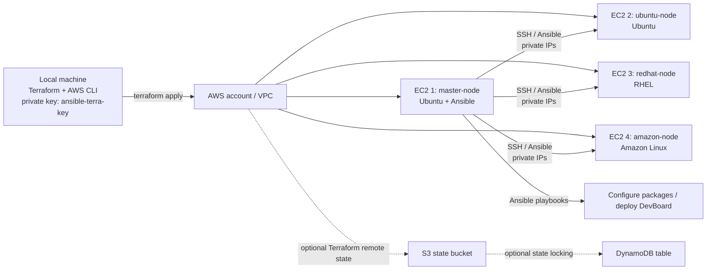

## 1. Architecture



### What runs where?

| Machine | Purpose | OS |
|---|---|---|
| Local machine | Run Terraform and AWS CLI; keep the private key | Ubuntu/Debian, macOS, or Windows with WSL |
| `master-node` | Control the other three nodes with Ansible | Ubuntu |
| `ubuntu-node` | Managed worker | Ubuntu |
| `redhat-node` | Managed worker | RHEL |
| `amazon-node` | Managed worker | Amazon Linux |

**Network design:** all four instances are placed in the default VPC for this starter lab. Ansible connects from the master to workers using their private IPs. The security group allows SSH to the master only from your IP, and SSH to workers only from the master security group. For production, use private subnets, Systems Manager Session Manager, and no public worker IPs.

## 2. Prerequisites

- An AWS account and a user/role allowed to create EC2 instances, key pairs, security groups, and related resources.
- AWS CLI and Terraform installed locally.
- A terminal and SSH client.
- An AWS region selected (examples use `ap-south-1`).
- Cost awareness: EC2 instances, EBS disks, public IPv4 addresses, and data transfer can incur charges. Destroy the lab when finished.

### Important security notes

- **Never commit `ansible-terra-key`, AWS secret keys, `.tfstate`, or `.tfvars` files to Git.**
- Do not use root access keys. Prefer an IAM role/temporary credentials and least-privilege policies.
- Avoid `AdministratorAccess` / full EC2, S3, and DynamoDB access unless you intentionally need it for a disposable lab. Use the minimum permissions required.
- This configuration uses the default VPC for simplicity. Verify the AMIs and VPC before applying.

## 3. Install Terraform on the local machine

```bash
sudo apt-get update
sudo apt-get install -y ca-certificates gnupg curl lsb-release unzip
sudo install -m 0755 -d /etc/apt/keyrings
curl -fsSL https://apt.releases.hashicorp.com/gpg | \
  sudo gpg --dearmor -o /etc/apt/keyrings/hashicorp-archive-keyring.gpg
sudo chmod a+r /etc/apt/keyrings/hashicorp-archive-keyring.gpg
echo "deb [signed-by=/etc/apt/keyrings/hashicorp-archive-keyring.gpg] https://apt.releases.hashicorp.com $(. /etc/os-release && echo "$VERSION_CODENAME") main" | \
  sudo tee /etc/apt/sources.list.d/hashicorp.list
sudo apt-get update
sudo apt-get install -y terraform
terraform -version
```

Official reference: https://developer.hashicorp.com/terraform/install

## 4. Install AWS CLI v2 on the local machine

```bash
sudo apt-get update
sudo apt-get install -y curl unzip
curl "https://awscli.amazonaws.com/awscli-exe-linux-x86_64.zip" -o "awscliv2.zip"
unzip awscliv2.zip
sudo ./aws/install
aws --version
rm -rf aws awscliv2.zip
```

For ARM64 Linux, use `https://awscli.amazonaws.com/awscli-exe-linux-aarch64.zip` instead. Official reference: https://docs.aws.amazon.com/cli/latest/userguide/getting-started-install.html

### Configure AWS credentials locally

```bash
aws configure
# AWS Access Key ID: enter a dedicated IAM user's access key, if using long-lived keys
# AWS Secret Access Key: enter its secret
# Default region name: ap-south-1
# Default output format: json

aws sts get-caller-identity
aws configure list
```

Use an approved short-lived credential method when available. Never paste secret keys into a README, Terraform file, chat, or shell command history.

## 5. Create the SSH key on your local machine

Create the key **locally** so the private key never needs to be downloaded from AWS. Terraform will upload only the public key to EC2.

```bash
mkdir -p ~/.ssh
ssh-keygen -t ed25519 -f ~/.ssh/ansible-terra-key -C "ansible-terra-key"
chmod 600 ~/.ssh/ansible-terra-key
chmod 644 ~/.ssh/ansible-terra-key.pub
```

When prompted for a passphrase, use one if your workflow supports it. For the Terraform example below, the public key path is `~/.ssh/ansible-terra-key.pub`; the private key stays on your local machine.

## 6. Create the Terraform project

```bash
mkdir -p ~/terraform-ansible-lab
cd ~/terraform-ansible-lab
touch provider.tf terraform.tf variables.tf ec2.tf output.tf
```

Project layout:

```text
terraform-ansible-lab/
├── provider.tf
├── terraform.tf
├── variables.tf
├── ec2.tf
└── output.tf
```

### 6.1 `terraform.tf`

Declares the Terraform and AWS provider versions.

```hcl
terraform {
  required_version = ">= 1.5.0"

  required_providers {
    aws = {
      source  = "hashicorp/aws"
      version = "~> 5.0"
    }
  }
}
```

### 6.2 `provider.tf`

```hcl
provider "aws" {
  region = var.aws_region
}

data "aws_vpc" "default" {
  default = true
}

data "aws_subnets" "default_vpc" {
  filter {
    name   = "vpc-id"
    values = [data.aws_vpc.default.id]
  }
}

data "aws_subnet" "selected" {
  id = data.aws_subnets.default_vpc.ids[0]
}

resource "aws_key_pair" "lab" {
  key_name   = var.key_name
  public_key = file(pathexpand(var.public_key_path))
}
```

This uses the first subnet returned from the default VPC. For a real deployment, choose a known subnet/AZ explicitly.

### 6.3 `variables.tf`

```hcl
variable "aws_region" {
  description = "AWS region for the lab"
  type        = string
  default     = "ap-south-1"
}

variable "key_name" {
  description = "AWS EC2 key-pair name (not the private-key filename)"
  type        = string
  default     = "ansible-terra-key"
}

variable "public_key_path" {
  description = "Path to the local SSH public key"
  type        = string
  default     = "~/.ssh/ansible-terra-key.pub"
}

variable "my_ip_cidr" {
  description = "Your public IP in CIDR notation, e.g. 203.0.113.10/32"
  type        = string
}

variable "instance_type" {
  description = "EC2 instance type for the lab"
  type        = string
  default     = "t3.micro"
}

variable "ubuntu_ami_id" {
  description = "Ubuntu Server 22.04/24.04 AMI ID in the selected region"
  type        = string
}

variable "rhel_ami_id" {
  description = "RHEL AMI ID in the selected region"
  type        = string
}

variable "amazon_linux_ami_id" {
  description = "Amazon Linux 2023 AMI ID in the selected region"
  type        = string
}
```

**AMI IDs are region-specific.** Find current IDs in the AWS EC2 console (Launch instance → choose OS → AMI ID) or the AWS Systems Manager public parameters. Do not copy an AMI ID from another region. Some RHEL images may have different pricing.

### 6.4 `ec2.tf`

```hcl
locals {
  nodes = {
    master-node = {
      ami           = var.ubuntu_ami_id
      user          = "ubuntu"
      role          = "ansible-master"
      public_access = true
    }
    ubuntu-node = {
      ami           = var.ubuntu_ami_id
      user          = "ubuntu"
      role          = "worker"
      public_access = false
    }
    redhat-node = {
      ami           = var.rhel_ami_id
      user          = "ec2-user"
      role          = "worker"
      public_access = false
    }
    amazon-node = {
      ami           = var.amazon_linux_ami_id
      user          = "ec2-user"
      role          = "worker"
      public_access = false
    }
  }
}

resource "aws_security_group" "lab" {
  name        = "terraform-ansible-lab-sg"
  description = "SSH to master from my IP; SSH to workers from master"
  vpc_id      = data.aws_vpc.default.id

  ingress {
    description = "SSH from your current public IP to master"
    from_port   = 22
    to_port     = 22
    protocol    = "tcp"
    cidr_blocks = [var.my_ip_cidr]
  }

  ingress {
    description     = "SSH from master to workers"
    from_port       = 22
    to_port         = 22
    protocol        = "tcp"
    security_groups = [aws_security_group.master_only.id]
  }

  egress {
    description = "Outbound traffic for package installation"
    from_port   = 0
    to_port     = 0
    protocol    = "-1"
    cidr_blocks = ["0.0.0.0/0"]
  }

  tags = { Name = "terraform-ansible-lab-sg" }
}

resource "aws_security_group" "master_only" {
  name        = "terraform-ansible-master-source"
  description = "Used as the source identity for worker SSH rules"
  vpc_id      = data.aws_vpc.default.id

  # No inbound ports are opened by this group. It is used as a source SG.
  tags = { Name = "terraform-ansible-master-source" }
}

# Explicit worker SSH rule: only instances associated with the master-source
# security group can SSH into instances using the lab security group.
resource "aws_vpc_security_group_ingress_rule" "workers_from_master" {
  security_group_id            = aws_security_group.lab.id
  referenced_security_group_id = aws_security_group.master_only.id
  ip_protocol                  = "tcp"
  from_port                    = 22
  to_port                      = 22
  description                  = "SSH from master source security group"
}

resource "aws_instance" "node" {
  for_each = local.nodes

  ami                         = each.value.ami
  instance_type               = var.instance_type
  subnet_id                   = data.aws_subnet.selected.id
  vpc_security_group_ids      = [aws_security_group.lab.id]
  key_name                    = aws_key_pair.lab.key_name
  associate_public_ip_address = each.key == "master-node"

  root_block_device {
    volume_size = 20
    volume_type = "gp3"
    encrypted   = true
  }

  tags = {
    Name = each.key
    Role = each.value.role
    OS   = each.key == "redhat-node" ? "RHEL" : (each.key == "amazon-node" ? "Amazon Linux" : "Ubuntu")
  }

  depends_on = [aws_vpc_security_group_ingress_rule.workers_from_master]
}
```

**Important correction before applying:** the master needs its own security group so the worker rule can trust the master only. Use the following corrected security-group arrangement instead of the security group section above if you want the intended restriction. Replace the `aws_security_group.lab` and `aws_security_group.master_only` blocks and the `aws_vpc_security_group_ingress_rule.workers_from_master` resource with:

```hcl
resource "aws_security_group" "master" {
  name   = "terraform-ansible-master-sg"
  vpc_id = data.aws_vpc.default.id

  ingress {
    description = "SSH from my public IP"
    from_port   = 22
    to_port     = 22
    protocol    = "tcp"
    cidr_blocks = [var.my_ip_cidr]
  }

  egress {
    from_port   = 0
    to_port     = 0
    protocol    = "-1"
    cidr_blocks = ["0.0.0.0/0"]
  }
}

resource "aws_security_group" "workers" {
  name   = "terraform-ansible-workers-sg"
  vpc_id = data.aws_vpc.default.id

  ingress {
    description     = "SSH from master security group"
    from_port       = 22
    to_port         = 22
    protocol        = "tcp"
    security_groups = [aws_security_group.master.id]
  }

  egress {
    from_port   = 0
    to_port     = 0
    protocol    = "-1"
    cidr_blocks = ["0.0.0.0/0"]
  }
}
```

Then in `aws_instance.node`, replace `vpc_security_group_ids = [aws_security_group.lab.id]` with:

```hcl
vpc_security_group_ids = each.key == "master-node" ? [aws_security_group.master.id] : [aws_security_group.workers.id]
```

And remove the `depends_on` line. This final arrangement is the recommended one: master and workers have different security groups.

### 6.5 `output.tf`

```hcl
output "master_public_ip" {
  description = "Public IP of the Ansible master"
  value       = aws_instance.node["master-node"].public_ip
}

output "master_public_dns" {
  value = aws_instance.node["master-node"].public_dns
}

output "worker_private_ips" {
  description = "Private IPs for Ansible inventory"
  value = {
    ubuntu = aws_instance.node["ubuntu-node"].private_ip
    redhat = aws_instance.node["redhat-node"].private_ip
    amazon = aws_instance.node["amazon-node"].private_ip
  }
}

output "instance_ids" {
  value = { for name, instance in aws_instance.node : name => instance.id }
}
```

### 6.6 Create `terraform.tfvars`

```hcl
aws_region       = "ap-south-1"
key_name         = "ansible-terra-key"
public_key_path  = "~/.ssh/ansible-terra-key.pub"
my_ip_cidr       = "YOUR_PUBLIC_IP/32"

# Replace these placeholders with real AMI IDs for ap-south-1:
ubuntu_ami_id       = "ami-REPLACE_WITH_UBUNTU_AMI"
rhel_ami_id         = "ami-REPLACE_WITH_RHEL_AMI"
amazon_linux_ami_id = "ami-REPLACE_WITH_AMAZON_LINUX_AMI"
```

Get your public IP from a trusted IP-check service, then enter it as `x.x.x.x/32`. Replace all AMI placeholders before running Terraform. Do not commit `terraform.tfvars`.

## 7. Terraform command sequence

Run inside `~/terraform-ansible-lab`:

```bash
terraform fmt -recursive
terraform init
terraform validate
terraform plan -out=tfplan
terraform show tfplan
terraform apply tfplan
```

After successful apply:

```bash
terraform output
terraform output -raw master_public_ip
terraform output -json worker_private_ips
aws ec2 describe-instances \
  --filters "Name=tag:Name,Values=master-node,ubuntu-node,redhat-node,amazon-node" \
  --query 'Reservations[].Instances[].[Tags[?Key==`Name`].Value|[0],State.Name,PrivateIpAddress,PublicIpAddress]' \
  --output table
```

Use `terraform destroy` only when you are ready to delete the resources created by this lab. Check the plan first:

```bash
terraform plan -destroy
terraform destroy
```

## 8. Connect to the master and copy the private key

Get the master IP:

```bash
terraform output -raw master_public_ip
```

From your **local machine**, copy the private key to the master only if you intentionally want the master to use that same key for worker SSH:

```bash
scp -i ~/.ssh/ansible-terra-key \
  ~/.ssh/ansible-terra-key \
  ubuntu@MASTER_PUBLIC_IP:/home/ubuntu/ansible-terra-key
```

Then connect:

```bash
ssh -i ~/.ssh/ansible-terra-key ubuntu@MASTER_PUBLIC_IP
```

On the master, secure the key:

```bash
chmod 400 /home/ubuntu/ansible-terra-key
ls -l /home/ubuntu/ansible-terra-key
```

**Security recommendation:** for a production system, do not copy private keys between hosts. Prefer AWS Systems Manager, short-lived SSH certificates, or a dedicated Ansible key stored in a secrets manager. For this lab, the copied key is a simple learning approach.

## 9. Install Ansible on the master node

On the Ubuntu master:

```bash
sudo apt-get update
sudo apt-get install -y ansible openssh-client python3 python3-apt git curl unzip
ansible --version
python3 --version
```

On Red Hat and Amazon Linux, Python must be available for most Ansible modules. Ansible will use SSH to reach the workers; make sure the image and security groups permit it.

### 9.1 Optional: AWS CLI on the master

Prefer attaching an IAM role to the master instead of storing long-lived IAM access keys on the EC2 instance. If the master genuinely needs AWS API access, attach a role with only the required permissions.

To install AWS CLI v2 on Ubuntu master:

```bash
curl "https://awscli.amazonaws.com/awscli-exe-linux-x86_64.zip" -o "awscliv2.zip"
unzip awscliv2.zip
sudo ./aws/install
aws --version
rm -rf aws awscliv2.zip
```

If you must configure a dedicated IAM user's credentials for a temporary lab:

```bash
aws configure
aws sts get-caller-identity
```

Do not use root credentials. S3 and DynamoDB permissions are only needed if your workflow actually accesses those services, such as using a remote Terraform state backend. EC2 permissions are not needed merely for ordinary Ansible-over-SSH management.

## 10. Verify SSH access from master to all workers

Terraform outputs the private IPs:

```bash
terraform output -json worker_private_ips
```

Use the values in the commands below. From the master:

```bash
ssh -i /home/ubuntu/ansible-terra-key ubuntu@UBUNTU_WORKER_PRIVATE_IP
ssh -i /home/ubuntu/ansible-terra-key ec2-user@REDSHAT_WORKER_PRIVATE_IP
ssh -i /home/ubuntu/ansible-terra-key ec2-user@AMAZON_WORKER_PRIVATE_IP
```

RHEL usernames can vary by AMI publisher; `ec2-user` is common for AWS-provided RHEL images, but confirm the selected AMI's connection instructions. Ubuntu normally uses `ubuntu`; Amazon Linux normally uses `ec2-user`.

On first connection, SSH may ask whether to trust the host fingerprint. Verify the fingerprint where possible before accepting. Do not disable host-key checking globally just to hide errors.

## 11. Create the Ansible project and inventory

On the master:

```bash
mkdir -p ~/ansible-lab/playbooks
cd ~/ansible-lab
touch hosts.ini
```

### `hosts.ini`

Replace the sample private IPs with the actual values from Terraform outputs.

```ini
[ubuntu_nodes]
ubuntu-node ansible_host=10.0.1.11 ansible_user=ubuntu

[redhat_nodes]
redhat-node ansible_host=10.0.1.12 ansible_user=ec2-user

[amazon_nodes]
amazon-node ansible_host=10.0.1.13 ansible_user=ec2-user

[workers:children]
ubuntu_nodes
redhat_nodes
amazon_nodes

[all:vars]
ansible_ssh_private_key_file=/home/ubuntu/ansible-terra-key
ansible_python_interpreter=auto_silent
```

Set safe permissions and test connectivity:

```bash
chmod 600 hosts.ini
chmod 400 /home/ubuntu/ansible-terra-key
ansible-inventory -i hosts.ini --graph
ansible all -i hosts.ini -m ping
ansible workers -i hosts.ini -m ping
```

Expected result: each reachable host returns `SUCCESS` and `pong`.

## 12. Ansible playbook 1: `playbooks/install.yml`

This playbook installs Git, Python, and Docker on the three workers, using OS-specific package managers. Docker package availability and service names can vary by RHEL/Amazon Linux release; if a package name is unavailable, use the distribution's official Docker installation instructions or Podman where appropriate.

```yaml
---
- name: Install baseline tools and Docker on all workers
  hosts: workers
  become: true
  gather_facts: true

  tasks:
    - name: Install common packages on Ubuntu
      ansible.builtin.apt:
        name:
          - git
          - curl
          - unzip
          - ca-certificates
          - python3
          - docker.io
        state: present
        update_cache: true
      when: ansible_facts.os_family == "Debian"

    - name: Install common packages on Red Hat family
      ansible.builtin.dnf:
        name:
          - git
          - curl
          - unzip
          - python3
          - docker
        state: present
      when: ansible_facts.os_family == "RedHat"

    - name: Enable and start Docker
      ansible.builtin.service:
        name: docker
        state: started
        enabled: true
      when: ansible_facts.os_family in ["Debian", "RedHat"]

    - name: Add default login user to docker group on Ubuntu
      ansible.builtin.user:
        name: "{{ ansible_user }}"
        groups: docker
        append: true
      when: ansible_facts.os_family == "Debian"

    - name: Add default login user to docker group on Red Hat family
      ansible.builtin.user:
        name: "{{ ansible_user }}"
        groups: docker
        append: true
      when: ansible_facts.os_family == "RedHat"
```

Run it:

```bash
ansible-playbook -i hosts.ini playbooks/install.yml
```

After a user is added to the Docker group, a new login session is needed for that group membership to take effect. Avoid using `newgrp docker` inside an Ansible playbook; start a fresh SSH session to test Docker.

## 13. DevBoard deployment: `playbooks/run_devboard.yml`

This is a **template**. Replace the repository URL and the app's actual Compose configuration/ports to match your repository. It assumes the repository contains a working `docker-compose.yml` or `compose.yaml` and that Docker Compose v2 is installed. The example deploys to the Ubuntu worker only.

```yaml
---
- name: Deploy DevBoard on Ubuntu worker
  hosts: ubuntu_nodes
  become: true
  vars:
    app_dir: /opt/devboard
    repo_url: "https://github.com/YOUR_GITHUB_USER/YOUR_DEVBOARD_REPO.git"
    compose_file: docker-compose.yml

  tasks:
    - name: Install Git and Docker Compose plugin
      ansible.builtin.apt:
        name:
          - git
          - docker.io
          - docker-compose-v2
        state: present
        update_cache: true

    - name: Ensure Docker is running
      ansible.builtin.service:
        name: docker
        state: started
        enabled: true

    - name: Create application directory
      ansible.builtin.file:
        path: "{{ app_dir }}"
        state: directory
        owner: root
        group: root
        mode: "0755"

    - name: Clone or update DevBoard repository
      ansible.builtin.git:
        repo: "{{ repo_url }}"
        dest: "{{ app_dir }}"
        version: main
        update: true

    - name: Check Compose file exists
      ansible.builtin.stat:
        path: "{{ app_dir }}/{{ compose_file }}"
      register: compose_file_status

    - name: Stop if Compose file is missing
      ansible.builtin.assert:
        that:
          - compose_file_status.stat.exists
        fail_msg: "No Compose file found. Set compose_file to docker-compose.yml or compose.yaml in your repo."

    - name: Start DevBoard with Docker Compose
      ansible.builtin.command:
        cmd: docker compose -f {{ compose_file }} up -d --build
        chdir: "{{ app_dir }}"
      changed_when: true

    - name: Show running containers
      ansible.builtin.command:
        cmd: docker ps
      register: docker_ps
      changed_when: false

    - name: Print running containers
      ansible.builtin.debug:
        var: docker_ps.stdout_lines
```

If the repository uses `compose.yaml`, set `compose_file: compose.yaml`. If the app needs environment variables, create them securely using Ansible Vault or a secrets manager; do not commit passwords or tokens.

Run the playbooks:

```bash
cd ~/ansible-lab
ansible-playbook -i hosts.ini playbooks/install.yml
ansible-playbook -i hosts.ini playbooks/run_devboard.yml
```

Useful additional commands:

```bash
ansible all -i hosts.ini -m shell -a "hostname"
ansible ubuntu_nodes -i hosts.ini -b -m shell -a "docker ps"
ansible-playbook -i hosts.ini playbooks/install.yml --check
ansible-playbook -i hosts.ini playbooks/install.yml --syntax-check
ansible-playbook -i hosts.ini playbooks/run_devboard.yml --syntax-check
```

## 14. Allow web access to DevBoard (only if needed)

The example security groups above expose **only SSH**. Do not open web ports until you know which service should be public. For a quick lab, add a separate ingress rule for HTTP/HTTPS to a designated web host and restrict it as appropriate. Prefer a load balancer and TLS for anything public-facing.

If the app listens on port 3000, 4173, or 8080, that port must be published by Compose and allowed by the security group. The actual port depends on the repo's Compose file; do not assume port 3000 or 8080 without checking.

On the app host:

```bash
docker ps
docker compose -f /opt/devboard/docker-compose.yml ps
docker compose -f /opt/devboard/docker-compose.yml logs --tail=100
curl -I http://127.0.0.1:APP_PORT
```

## 15. Troubleshooting quick reference

### Terraform

```bash
terraform fmt -check -recursive
terraform validate
terraform providers
terraform state list
terraform output
TF_LOG=INFO terraform plan
```

- **`terraform: command not found`**: install Terraform and open a new terminal; verify `terraform -version`.
- **Provider/plugin not installed**: run `terraform init`; rerun it after provider/module/backend configuration changes.
- **Invalid AMI**: AMI ID is wrong, retired, or from another region. Check `aws_region` and select a current AMI.
- **No default VPC/subnet**: create or explicitly configure a VPC/subnet rather than using the default-VPC data source.
- **AccessDenied**: check the IAM identity with `aws sts get-caller-identity` and grant only the missing required permissions.
- **Key pair already exists**: use a unique `key_name` or import/adopt the existing resource deliberately.
- **Quota or capacity error**: check EC2 quotas, instance availability, and the selected instance type/AZ.
- **Unexpected resources**: inspect `terraform plan` before applying; do not blindly use `-auto-approve`.

### SSH / Ansible

```bash
chmod 400 ~/.ssh/ansible-terra-key
chmod 400 /home/ubuntu/ansible-terra-key
ssh -vvv -i /home/ubuntu/ansible-terra-key ubuntu@MASTER_PUBLIC_IP
ansible-inventory -i hosts.ini --list
ansible all -i hosts.ini -m ping -vvvv
```

- **`Permission denied (publickey)`**: wrong username, wrong key, key permissions, or the matching public key was not installed on the instance.
- **Timeout / unreachable**: check instance state, route table, internet path, security-group source, NACLs, and that the worker's SSH rule trusts the master's security group.
- **Host key changed**: verify the host identity first. Only then remove a stale entry with `ssh-keygen -R WORKER_PRIVATE_IP`.
- **Python missing**: install Python on the target using SSH/cloud-init or the provider's supported bootstrap method.
- **Ansible `UNREACHABLE`**: test raw SSH from the master before debugging playbooks.
- **RHEL package failure**: confirm the RHEL version, enabled repositories, package names, and AMI login user.
- **Docker permission denied**: reconnect after group membership change, or use `become: true` for Docker tasks.
- **Docker service not found**: install/enable the correct engine package for that OS release; Amazon Linux may use Docker or Podman depending on release.

### DevBoard

```bash
docker ps -a
docker logs CONTAINER_NAME
docker compose -f /opt/devboard/docker-compose.yml config
docker compose -f /opt/devboard/docker-compose.yml up -d --build
ss -lntp
```

- **Compose file not found**: confirm the repository URL, branch, directory, and file name.
- **Container exits repeatedly**: inspect logs and environment variables.
- **Cannot access app from browser**: verify app bind address, Compose port mapping, instance public/private routing, and the security group.
- **Port already in use**: identify the listener with `sudo ss -lntp` and change the host port mapping if appropriate.

## 16. Cleanup

When you have finished the lab, from the Terraform project directory:

```bash
terraform plan -destroy
terraform destroy
```

Then check the EC2 console for any resources created outside Terraform. Deleting instances does not necessarily delete manually created key pairs, S3 buckets, or other unrelated resources.

## 17. Official references

- Terraform install: https://developer.hashicorp.com/terraform/install
- AWS provider docs: https://registry.terraform.io/providers/hashicorp/aws/latest/docs
- AWS CLI install: https://docs.aws.amazon.com/cli/latest/userguide/getting-started-install.html
- EC2 key pairs: https://docs.aws.amazon.com/AWSEC2/latest/UserGuide/ec2-key-pairs.html
- Ansible installation: https://docs.ansible.com/ansible/latest/installation_guide/intro_installation.html
- Ansible inventory: https://docs.ansible.com/ansible/latest/inventory_guide/intro_inventory.html
- Ansible playbooks: https://docs.ansible.com/ansible/latest/playbook_guide/playbooks_intro.html

---

**Final workflow:** Local machine → `terraform init` → `terraform validate` → `terraform plan` → `terraform apply` → SSH to master → install Ansible → configure `hosts.ini` → `ansible all -m ping` → run install playbook → run DevBoard deployment playbook → verify containers and app endpoint.
"""

out = Path("/mnt/data/README_Terraform_Ansible_DevBoard.md")
pypandoc.convert_text(md, "md", format="md", outputfile=str(out), extra_args=["--standalone"])
print(f"Created: {out}")
print(f"Size: {out.stat().st_size:,} bytes")
